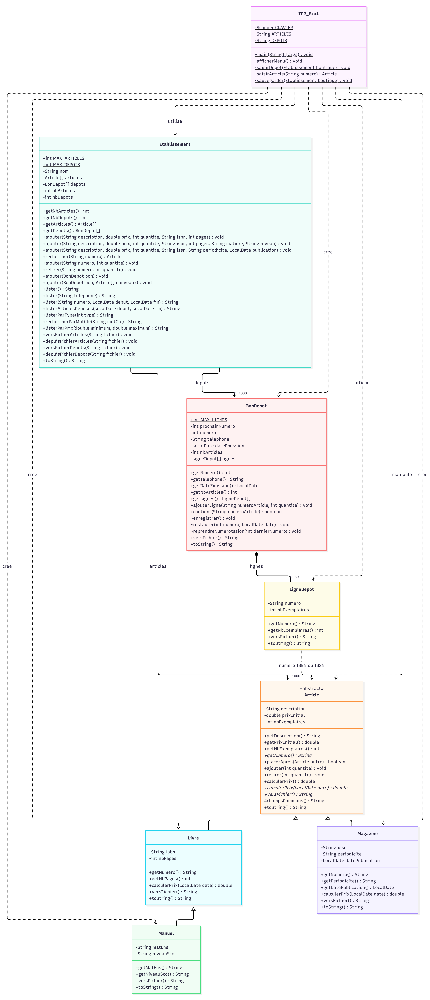

# Gestion d’une boutique

**Participants :** Lucas Singhavara, Loc Tran, Alexandre Piana, Noé Ballu  
**Formation :** Ing1-Apprenti  
**Groupe :** BDML 1  
**Enseignante :** Madame Georgina ABI SEJAAN  
**Environnement :** Java et NetBeans

## Fonctionnalités

1. Lister les articles par stock croissant : Permet d'avoir une vue d'ensemble des stocks actuels, du plus faible au plus élevé.
2. Enregistrer un dépôt : Ajout de stock pour des articles nouveaux (création de fiche) ou déjà existants.
3. Retirer des exemplaires vendus : Mise à jour du stock après une vente.
4. Rechercher un article : Recherche rapide via le numéro ISBN (13 chiffres) ou ISSN (8 chiffres).
5. Lister les dépôts d'un client : Historique des dépôts retrouvés grâce au numéro de téléphone du déposant.
6. Lister les dépôts d'un article sur une période : Permet de cibler les dépôts d'une référence précise entre deux dates.
7. Afficher tout l'établissement : Affiche la totalité du catalogue et l'historique complet des dépôts.
8. Sauvegarder : Enregistre l'état actuel dans des fichiers texte (articles.txt et depots.txt). (Note : le chargement est automatique au lancement).
0. Sauvegarder et quitter : Quitte le programme en sauvegardant les données en toute sécurité.

9. Rechercher les articles déposés sur une période : Calcule et affiche les quantités cumulées déposées par référence entre deux dates données.
10. Afficher les articles par type : Permet de filtrer le catalogue pour n'afficher que les Livres, les Manuels, ou les Magazines.
11. Rechercher un article par mot-clé : Recherche un terme spécifique dans la description des articles (sans distinction de majuscules/minuscules).
12. Rechercher les articles par fourchette de prix : Filtre le catalogue en fonction du prix actuel, en prenant en compte les réductions appliquées (ex: réductions périodiques sur les magazines).

## Vérification des recherches

Depuis la racine du projet, avec un JDK installé :

```powershell
javac -encoding UTF-8 -d build/test/classes src/tp2_exo1/*.java test/tp2_exo1/EtablissementRechercheTest.java
java -ea "-Dfile.encoding=UTF-8" -cp build/test/classes tp2_exo1.EtablissementRechercheTest
```

Les tests utilisent leurs propres données et ne modifient pas les fichiers du dossier `data`.

## Organisation des classes

| Classe | Responsabilité |
|---|---|
| `Article` | Classe abstraite regroupant les informations communes : description, prix initial et stock. |
| `Livre` | Ajoute l’ISBN et le nombre de pages. |
| `Manuel` | Spécialise un livre avec une matière et un niveau scolaire. |
| `Magazine` | Ajoute l’ISSN, la périodicité et la date de publication. |
| `Etablissement` | Gère les articles, les stocks, les dépôts et les fichiers. |
| `BonDepot` | Regroupe les lignes d’un dépôt, sa date et le téléphone du déposant. |
| `LigneDepot` | Conserve la référence d’un article et la quantité déposée. |
| `TP2_Exo1` | Gère le menu et les saisies de l’utilisateur. |


## Diagramme de classes



